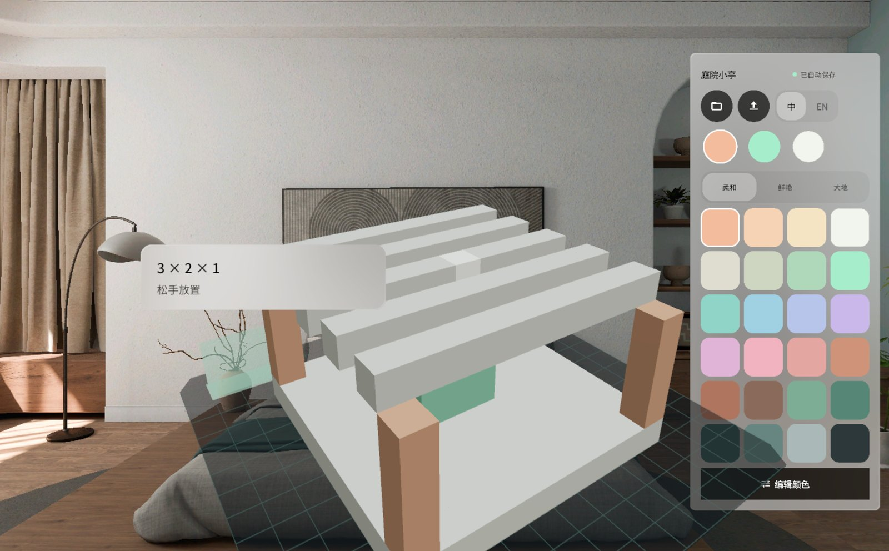

# GridSpace · 格间

A lightweight voxel editor for PICO OS 6, built with the PICO Spatial SDK (Kotlin, SpatialUI Compose + ECS).
The model floats in a Volumetric window in your room; the tools sit around it as glass cards.



## What it does

- **Place blocks on a grid.** Look at a cell, pinch, release: the ghost block snaps to the grid, a footprint and a
  guide column show where it lands, and the label tells you the cell. Choose a block size with the W × H × D steppers
  under the model (1 × 1 × 1 up to 16 × 16 × 16); the block flips or clips at the grid edge and skips occupied cells.
- **Four modes.** Add, erase, paint and select, on the system toolbar under the Volume, with undo / redo and reset view.
- **Move a selection by dragging it.** In select mode, pinch a selected block and drag: the whole selection moves by whole
  cells with a live ΔX · ΔY · ΔZ readout; the side panel also rotates, duplicates, deletes and nudges the selection.
- **Colour rail.** Three colour slots, three preset palettes (Soft / Vivid / Earth), an HSL editor and an eyedropper,
  always visible on the right of the model. New projects start white.
- **Projects and export.** Autosave, a recent-projects sheet, and export to MagicaVoxel `.vox` in `Download/GridSpace/`.
- **Bilingual.** Chinese and English, switchable from the entry window or the colour rail; Noto Sans / Noto Sans SC bundled.
- **Any input.** Gaze + pinch, direct hand interaction and controllers all drive the same spatial gestures.

## Build

```bash
export JAVA_HOME="C:/Program Files/Android/Android Studio/jbr"   # any JDK 17 works
./gradlew :app:assembleDebug
./gradlew :app:testDebugUnitTest
adb install -r app/build/outputs/apk/debug/app-debug.apk
```

Requires the PICO Spatial SDK 6.1.9 artifacts (BOM) in your Gradle repositories. On the PICO emulator the app can
replay scripted demos for screenshots: `adb shell settings put global gridspace_demo walk` (`sample`, `export`, `size`,
`edit`, `newproject` are the other scripts; delete the setting afterwards). `AGENTS.md` documents the build rules, the
verified SDK facts and the emulator quirks; `docs/` holds the design specs and the round-by-round dev / QA reports.

## Status

Verified on the PICO emulator (build, 60 unit tests, scripted walkthrough in both languages, no crashes).
Not yet verified on a headset: the size of the system toolbar, the placement constants of the side cards, and the
feel of pinch-drag input.

## Design

Figma: https://www.figma.com/design/Ressf4W2H8TeXKfjl5O649/ (section "GRIDSPACE V2 · 空间化改版").
Specs: `docs/DESIGN_SPEC.md` (v1.0) and `docs/DESIGN_SPEC_R4.md` (sections M–T, acceptance list K4).

## License

MIT. Noto Sans and Noto Sans SC are bundled under the SIL Open Font License (see `app/src/main/assets/fonts/`).
