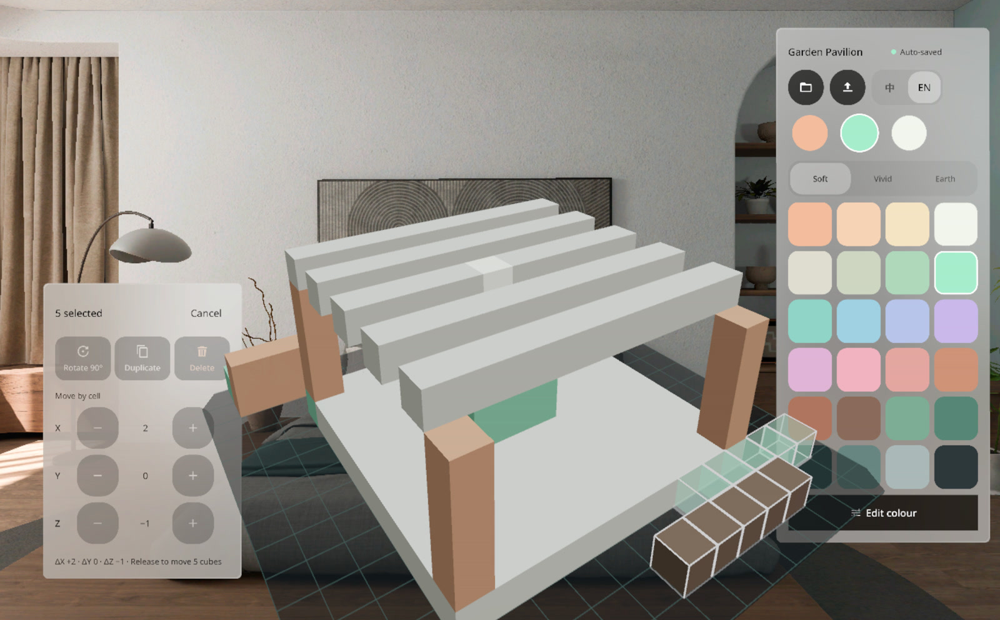

# GridSpace | 格间

A voxel editor for PICO OS 6 Shared Space: a volumetric window holds a 16 x 16 x 16 block model you build at arm's length in your own room, fully offline with every project auto-saved on the headset. Pick a block size (W x H x D), point at the base plate or an existing cube and tap to place; pinch-hold shows a mint ghost of where the block will land, and erase, paint and select modes act on the same grid. Select a group of cubes to move them cell by cell, rotate or duplicate them, choose from three palettes or edit any colour with the eyedropper, undo / redo freely, switch Chinese / English live and export the model as a MagicaVoxel `.vox` file to Downloads.



## Install

```
adb install -r GridSpace-v1.0.0.apk
```

Then launch GridSpace from the PICO library; the entry window lists recent projects and the sample pavilion.

## Links

PRD: to be added | Figma: https://www.figma.com/design/Ressf4W2H8TeXKfjl5O649/ | GitHub: https://github.com/kejing-dev/GridSpace
