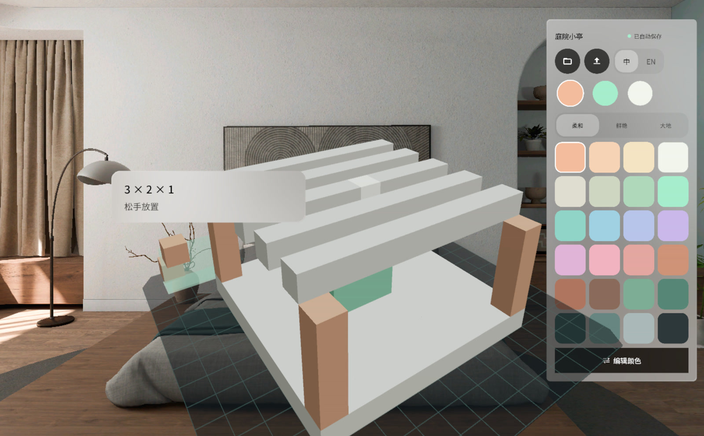

# GridSpace | 格间

放在房间里的体素编辑器：共享空间（Shared Space）里的一个体积窗口装着 16 × 16 × 16 的方块模型，伸手可及，离线使用，每个项目都自动保存在头显本机。先选好笔刷尺寸（宽 × 高 × 深），指向底座或已有方块轻点即可放置；捏住不放会先显示一块薄荷色的预览，擦除、上色、选择三种模式都作用于同一张网格。框选一组方块可以逐格移动、旋转 90°、复制，三组调色板之外还能用取色器编辑任意颜色，撤销 / 重做随意，中英文即时切换，模型可导出为 MagicaVoxel `.vox` 文件到下载目录。



## 安装

```
adb install -r GridSpace-v1.0.0.apk
```

安装后在 PICO 应用库启动「格间」，入口窗口列出最近项目和示例「庭院小亭」。

## 链接

PRD：待补充 | Figma：https://www.figma.com/design/Ressf4W2H8TeXKfjl5O649/ | GitHub：https://github.com/kejing-dev/GridSpace
